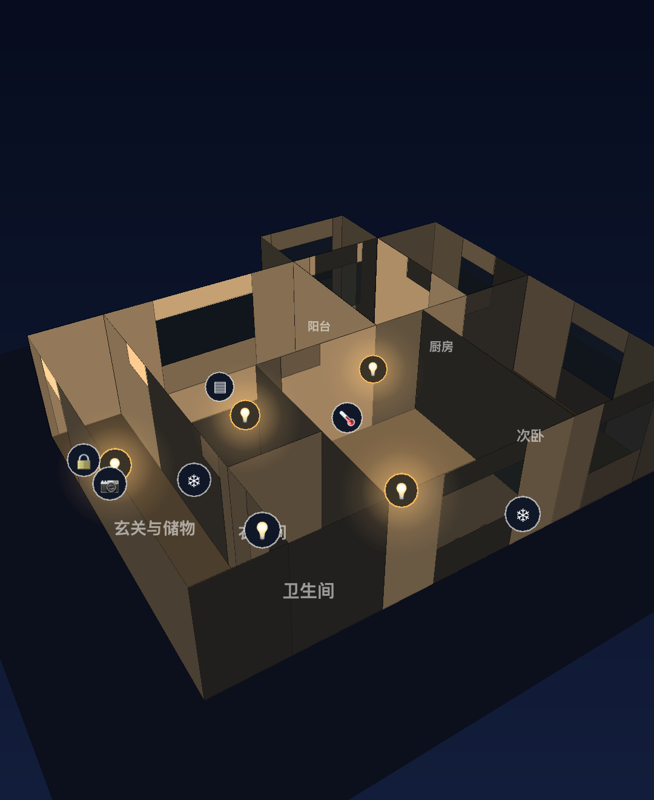
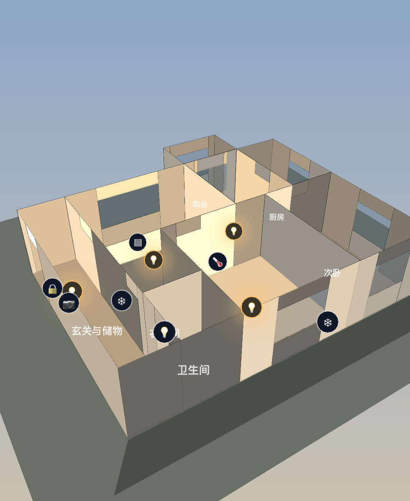
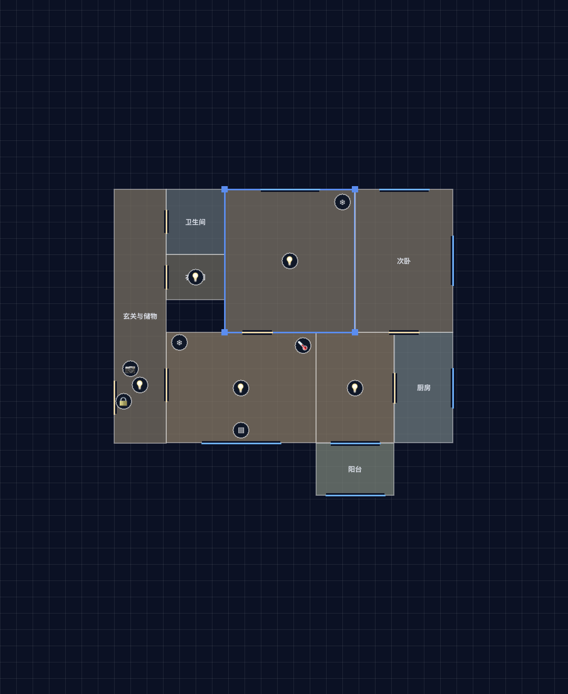
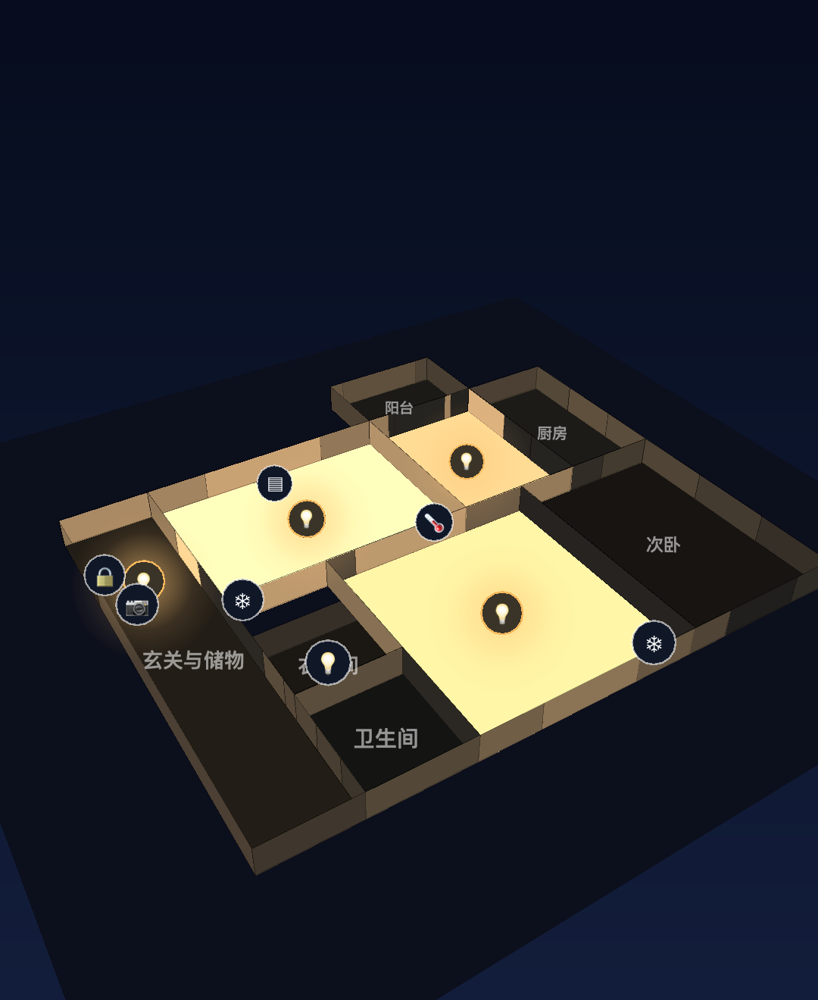

# HomeTwin · 家的数字孪生

深蓝夜色风格的智能家居面板：**3D 户型 + 光影 + 昼夜切换 + 可编辑户型 + Home Assistant 真实数据**。

<p align="center">
  
  
  
</p>

Kotlin + Jetpack Compose 原生实现（当前为 Android 版），3D 渲染是自写的轻量软件渲染器——Canvas 透视投影 + 画家算法 + Lambert 面光照，无任何第三方 3D 库。户型数据格式参考 [0xProbabillity/house-control](https://github.com/0xProbabillity/house-control) 的 plan.json 思路。

## 效果展示

| 夜晚 · 灯光暖光与地面光晕 | 白天 · 太阳直射与建筑投影 | 低墙透视 · 俯瞰全屋 |
| --- | --- | --- |
|  |  |  |

- **真 3D**：单指环绕、双指缩放，点 3D 场景中的设备/房间可直接选中（屏幕空间拾取）
- **光影**：每面按法线做 Lambert 光照。白天有方向性太阳光 + 建筑在地面上的斜投影；夜晚环境光压暗，每盏开着的灯作为点光源给墙地打暖光，地板带径向光晕，窗户半透明玻璃
- **昼夜一键切换**：0.9 秒动画在夜色深蓝与白天天光之间插值（背景、环境光、阴影透明度整体渐变）
- **低墙透视**：一键在全高墙 / 低墙模式间切换，俯瞰全屋动线

## 功能

- **四 Tab**：全屋（3D + 场景 + 房间筛选 + 设备卡片）/ 设备（按房间分组）/ 日历 / 我的
- **设备控制**：点 3D 场景或卡片打开详情弹层（电源、亮度、空调温度），状态实时反映到 3D 灯光
- **场景**：归家 / 离家 / 睡眠，批量开关设备
- **户型编辑器**（我的 → 户型编辑器）：
  - 房间为轴对齐矩形（L 形拆成两个矩形拼接）
  - 拖动移动房间、选中后拖四角调整尺寸，0.1m 网格吸附
  - 添加/删除房间、改名称/类型/地板颜色
  - 门、窗挂房间边（北/东/南/西），可拖动位置、调宽度
  - 设备可添加、拖动摆放、改所属房间
  - plan.json 存本地，支持导出剪贴板 / 导入 / 恢复默认

## Home Assistant 接入

「我的」页填写 HA 地址和长期访问令牌（HA 个人资料页底部创建），点「连接 HA」：

- **拉取**：REST `GET /api/states` 全量同步一次实体状态
- **实时**：WebSocket `/api/websocket` 鉴权后订阅 `state_changed`，状态变化毫秒级推送到 3D 场景和卡片
- **控制**：开关/亮度/温度经 REST `POST /api/services/...` 下发（light/switch/climate/cover/lock）
- **绑定**：设备 ↔ 实体通过 `entityId` 字段；「自动匹配设备」按域名 + friendly_name 包含关系自动绑定，也可在「绑定列表」手动填写
- 状态映射：`brightness`(0-255)→百分比、`hvac_mode`、`current_position`、传感器带单位读数；`unavailable/unknown` 显示为设备不可用
- 未连接时本地状态兜底（演示模式），令牌仅存手机本地

## 远程访问（不在同一局域网）

连接策略：**局域网优先探测，不可达自动切远程；断线 5 秒自动重连**（网络切换、出门/回家无感）。

远程地址三选一（填在「远程地址」一栏，必须 https）：
1. **Nabu Casa**：HA 设置面板一键开通的官方云（付费），得到 `https://xxx.ui.nabu.casa`
2. **Cloudflare Tunnel / frp**：自建隧道（免费），把 HA 的 8123 端口映射到自己的 https 域名
3. **Tailscale / WireGuard**：手机装 VPN 组成虚拟局域网，远程地址留空，仍用局域网地址

实现说明：`HaClient.probe()` 先探测（200 可用 / 401 令牌错 / -1 不可达），WebSocket 的 https→wss 转换已内置；Manifest 已开 `usesCleartextTraffic` 以支持局域网 http 地址。

## plan.json 格式

```json
{
  "home": { "name": "我的家", "wallHeight": 2.6 },
  "rooms":  [ { "id": "living", "name": "客厅", "type": "living", "x": 1.6, "y": 4.4, "w": 4.6, "h": 3.4, "floorColor": "#8A7B66" } ],
  "openings": [ { "id": "d1", "roomId": "living", "edge": 2, "offset": 2.3, "width": 2.4, "type": "window" } ],
  "devices": [ { "id": "light.living", "name": "客厅灯", "type": "light", "roomId": "living", "x": 3.9, "y": 6.1, "capabilities": ["power","brightness"] } ],
  "scenes":  [ { "id": "home", "name": "归家", "actions": [ { "deviceId": "light.living", "on": true, "brightness": 90 } ] } ]
}
```

坐标单位为米；`edge`: 0=北 1=东 2=南 3=西；设备 type: light / ac / curtain / sensor / camera / switch / lock。

## 构建

需要 JDK 17+ 和 Android SDK（Platform 35 + Build-Tools 34）。Android Studio 直接打开同步即可；命令行：

```bash
export JAVA_HOME=<jdk17+>
export ANDROID_HOME=<android-sdk>
./gradlew assembleDebug   # 产物: app/build/outputs/apk/debug/app-debug.apk
```

> 国内网络加速：Gradle 发行版可换腾讯镜像（`mirrors.cloud.tencent.com/gradle`），Maven 依赖走阿里云镜像（本仓库 `settings.gradle.kts` 已内置，排在 google()/mavenCentral() 之前）。

## 目录

```
app/src/main/java/com/cottonchou/hometwin/
├── data/       PlanModels（户型模型）、PlanRepository（plan.json 存取）、HomeViewModel
│   └── ha/     HaClient（HA REST + WebSocket 客户端）
├── engine/     SceneBuilder（plan → 网格）、Renderer3D（投影/光照/光晕/标记）
├── ui/         MainActivity（四 Tab）、HomeScreen、Home3DView、DeviceDetailSheet、Devices/Calendar/Profile
└── ui/editor/  EditorScreen + EditorPanel（2D 户型编辑器）
```

## Roadmap

- [ ] iOS / macOS 客户端（复用 plan.json 格式与渲染思路）
- [ ] 门窗传感器联动灯光、自动化（日历 Tab 的日程目前是本地示例）
- [ ] 多楼层支持（`home.floorHeight` 已预留）
- [ ] HA 长连接前台保活与推送

## License

[MIT](LICENSE)
